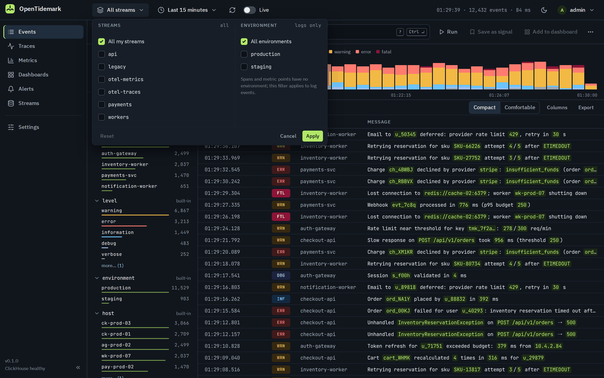

<!-- SPDX-License-Identifier: Apache-2.0 -->
# OpenTidemark — open-source, self-hosted log management, metrics and distributed tracing

**OpenTidemark is an open-source, self-hosted observability platform for logs, metrics and
distributed traces.** It accepts **OpenTelemetry®** (OTLP gRPC and HTTP), the **Seq** ingestion API
used by Serilog and NLog, **Elasticsearch `_bulk`** from Filebeat, Fluent Bit and Vector, and
JSON from Logstash's `http` output, so existing clients change little more than a URL and an API
key. Telemetry is stored in **ClickHouse®**, and the web UI offers a workflow familiar to Seq and
Kibana users: a self-hosted alternative to Seq and to Elasticsearch/Kibana that you run on your
own hardware. It is licensed under [Apache-2.0](LICENSE): every feature is included and the
number of users is not limited.

> **Status: early 0.x release.** Ingestion, search, the web UI, dashboards, alerting, stream
> management, high availability and the importers are implemented and tested. Expect rough edges
> and breaking changes between minor versions before 1.0 (your data is always kept on upgrade).
> See the [changelog](CHANGELOG.md) and the [releases](https://github.com/ZeraOrg/opentidemark/releases).

## Why OpenTidemark

Logs, metrics and traces are how you find out what your software is really doing. That insight
should be available to everyone, not only to companies that can pay per-gigabyte SaaS prices.
OpenTidemark is meant to run on your own hardware, and to be something you can trust there:

- **Your telemetry stays with you.** OpenTidemark sends no telemetry and never phones home with
  your data. Its only connection of its own is a once-a-day check for a newer release on
  `api.github.com` (and the release download from GitHub when an admin installs an update), which
  sends no installation data and is turned off with `TIDEMARK_UPDATE_CHECK=false` (development
  builds never check). Otherwise it only connects
  where you configure it to: ClickHouse, PostgreSQL in high-availability mode, your alert channels (webhooks through an
  SSRF-safe client, and SMTP), the sources you import from, and the `tidemark healthcheck` probe.
- **The web UI loads nothing from third parties.** Its Content Security Policy is
  `default-src 'self'` and its fonts are bundled.
- **Secrets are protected at rest.** Passwords are hashed with argon2id; connection keys, API
  tokens and sessions are stored only as SHA-256 hashes; channel secrets are encrypted with
  AES-GCM.
- **Open, with nothing held back.** Apache-2.0, every feature included, no editions, licence keys
  or user limits, and you can read every line of code.
- **Verifiable releases.** Each release has `checksums.txt` and GitHub build provenance
  attestations for the archives and the container image; releases after 0.4.0 also sign
  `checksums.txt` with minisign (keys in [SECURITY.md](SECURITY.md)). A release is only published
  when its Go and npm dependencies pass a supply-chain scan for known vulnerabilities and
  malicious packages.
- **Your machine, your choice.** It runs on your own Linux or Windows machine, or in Docker.

## About

OpenTidemark puts logs, traces and metrics in one place. Applications keep their existing clients
and only change a URL and an API key. Everything is searched with one query language, from a
quick `level:error service:checkout*` to `stats` pipelines, and any result can become a
dashboard panel or an alert. The screenshots below use the web UI's built-in demo data.


*Log explorer: a time histogram, saved signals, field facets with top values, and an event
stream with message-template values highlighted.*


*Event detail: properties with filter, exclude, show in column and copy actions, the exception
with collapsed framework frames, and related events. Here `host` and `Provider` are shown as
columns in the event list.*

| | |
|---|---|
|  |  |
| **Traces:** waterfall with the critical path, span attributes and the span's own logs. | **Dashboards:** variables, stat tiles with sparklines, line, area and stacked-bar charts, and tables. |
|  |  |
| **Metrics:** browse metric names and chart any of them by service, ready to add to a dashboard. | **Alerts:** rules on any query, with a preview against recent data, grouping and notification channels. |
|  |  |
| **Scope:** narrow any view to some of your streams and, for logs, an environment; the choice is in the URL. | **Teams:** admins grant each team the streams its members may see; everyone else sees only their teams' streams. |

## Features

- **Works with your existing clients.** Serilog and NLog (Seq protocol), Filebeat, Fluent Bit and
  Vector (Elasticsearch `_bulk`), Logstash (`http` output to the native JSON endpoint), and
  **OpenTelemetry** (OTLP gRPC/HTTP) for logs, traces and metrics. Applications only change a URL
  and an API key.
- **Search that's easy and powerful.** Start with `level:error service:checkout*` and grow into
  `level >= warning | stats count() by service span 5m`.
- **A web UI for everything.** Log explorer with live tail, trace waterfall, metrics browser,
  dashboards with a visual panel builder, alerts, streams, connections and settings.
- **Access by team.** Admins group users into teams and grant each team the streams it may see;
  every search, trace, metric and alert respects it, and a scope picker narrows any view to some
  of your streams or environments.
- **Dashboards and alerts.** Add query results to dashboards; alert on any query with webhook,
  Slack, Teams or email notifications.
- **Index management.** Streams, retention rules, storage stats, field mappings, indexed fields and
  purge.
- **Secure by default.** Every ingestion connection has its own API key; strict web security
  throughout (see [SECURITY.md](SECURITY.md)).
- **Durable and optionally highly available.** A write-ahead log keeps acknowledged data, upgrades
  never lose data, and several nodes can run behind a load balancer.
- **Easy migration.** `tidemark import` moves data and saved searches from Seq and
  Elasticsearch/OpenSearch.
- **Update notices and one-click updates.** Admins can see when a newer release is out
  (`GET /api/v1/system/update`); the daily check can go through an explicit proxy or be turned
  off. Native Linux and Windows service installs can install it in one step from the Updates card
  or through `POST /api/v1/system/update/apply`: the release is verified against its signature,
  installed by a separate privileged helper and rolled back if the new version doesn't come up.
- **Runs on Linux and Windows** as a single binary or with Docker Compose.

## Quick start

OpenTidemark needs a ClickHouse server. To try it on your own computer, follow the step-by-step
[local quick-start guide](docs/quickstart.md). For servers, native services, hardening, upgrades
and troubleshooting on every platform, see the [installation guide](docs/installation.md). Pick
one of these ways to install it:

### Docker Compose bundle (Linux, macOS, Windows)

Download `tidemark_<version>_docker.tar.gz` (or `.zip`) from the
[releases page](https://github.com/ZeraOrg/opentidemark/releases). It contains a Compose file that
runs the published image `ghcr.io/zeraorg/tidemark:<version>` (linux/amd64 and linux/arm64)
together with ClickHouse, the installers and an `INSTALL.md`; nothing is built. (The bundle is
part of every release after 0.1.0; for 0.1.0 use the source tree below.)

```bash
tar -xzf tidemark_<version>_docker.tar.gz
cd tidemark_<version>_docker
./install.sh docker      # creates .env with random passwords and an ingest key, then starts the stack
```

On Windows run `Unblock-File` on the downloaded `.zip` (so PowerShell lets the installer run), unpack
it and run `.\install.ps1 -Mode Docker` in PowerShell.

### Release archive (native install)

Download the archive for your platform from the
[releases page](https://github.com/ZeraOrg/opentidemark/releases) and check it against
`checksums.txt` (`sha256sum -c checksums.txt --ignore-missing`), after checking the signature of
`checksums.txt` on releases after 0.4.0 (see [SECURITY.md](SECURITY.md#verifying-releases)).
Each archive contains the `tidemark` binary with the web UI built in, an `INSTALL.md` for its platform, the licence files
and the installer files in `deploy/`. ClickHouse is set up separately with the users from
`deploy/clickhouse/users.d`.

```bash
tar -xzf tidemark_<version>_linux_amd64.tar.gz     # or linux_arm64
cd tidemark_<version>_linux_amd64
sudo ./deploy/install.sh native ./tidemark --start   # systemd service, config in /etc/tidemark
```

On Windows run `Unblock-File` on `tidemark_<version>_windows_amd64.zip`, unpack it and run
`.\deploy\install.ps1 -Mode Native -Binary .\tidemark.exe -Start` as Administrator (a Windows
service; run ClickHouse with Docker Desktop).

### From source

```bash
git clone https://github.com/ZeraOrg/opentidemark
cd opentidemark/deploy
./install.sh docker                 # builds the image from source and starts the stack
```

This is also the way to try unreleased changes.

On Windows use `.\install.ps1 -Mode Docker`. See [Building from source](#building-from-source)
for the binaries.

### First steps

The Compose stack publishes its ports on every network interface; set `TM_BIND_ADDR=127.0.0.1`
in `.env` (next to `docker-compose.yml`) to keep them on the local computer. When others use it,
set `TIDEMARK_PUBLIC_URL` to the address they open in the browser (used in alert links and
connection snippets).

Open <http://localhost:8080> and sign in with **admin / admin**. **Change the password right
away** (see [SECURITY.md](SECURITY.md)), then create a connection (one API key per application or
shipper) and point your clients at OpenTidemark ([Sending data](docs/ingestion.md)).

## Documentation

The documentation is published at <https://zeraorg.github.io/opentidemark/>; the same pages are in
[`docs/`](docs/), every release attaches them as an offline copy (`tidemark_<version>_docs.zip`,
with search), and the site offers them to agents as
[`llms.txt`](https://zeraorg.github.io/opentidemark/llms.txt) and
[`llms-full.txt`](https://zeraorg.github.io/opentidemark/llms-full.txt):

- [Quick start: run OpenTidemark locally](docs/quickstart.md)
- [Installation guide](docs/installation.md) (Docker Compose, native Linux and Windows, macOS for
  development, hardening, upgrades, backups, troubleshooting)
- [Query language (TQL)](docs/query-language.md)
- [Sending data (ingestion)](docs/ingestion.md)
- [Configuration](docs/configuration.md)
- [Migrating from Seq](docs/migrate-from-seq.md) and
  [from Elasticsearch/Kibana](docs/migrate-from-elastic.md)
- [Operations manual](docs/manual/index.md) for engineers and automation agents: deployment
  topologies, security hardening, users and teams, ingestion recipes, metrics, retention,
  dashboards, alerting, day-2 operations, the automation API and a
  [guide for agents](docs/manual/agents.md)
- [Security policy and hardening](SECURITY.md)
- [Changelog](CHANGELOG.md)
- [Specification](SPEC.md) (design, architecture and every detail of the behaviour)

## Building from source

Go 1.26 and Node 22 are required.

```bash
make build    # web UI + bin/tidemark
make check    # gofmt, go vet, golangci-lint, tests with -race, govulncheck, web checks
make dist     # release archives + checksums.txt in dist/, version from the VERSION file
```

On Windows use `.\build.ps1 build`, `.\build.ps1 check` and `.\build.ps1 dist`.

## Releases

Releases follow [Semantic Versioning](https://semver.org); before 1.0, minor versions may contain
breaking changes. Each [release](https://github.com/ZeraOrg/opentidemark/releases) has:

- `tidemark_<version>_linux_amd64.tar.gz`, `tidemark_<version>_linux_arm64.tar.gz` and
  `tidemark_<version>_windows_amd64.zip`: the binary, the native installer and an `INSTALL.md`;
- `tidemark_<version>_docker.tar.gz` and `.zip`: the ready-to-use Docker Compose bundle;
- `tidemark_<version>_docs.zip`: the documentation for offline use (open `index.html`);
- `checksums.txt`, its minisign signature `checksums.txt.minisig` (releases after 0.4.0; keys in
  [SECURITY.md](SECURITY.md)) and build provenance attestations
  (`gh attestation verify <file> --repo ZeraOrg/opentidemark`; for 0.2.0 and earlier, published
  before the repository was renamed, `--repo ZeraOrg/tidemark`);
- the matching image `ghcr.io/zeraorg/tidemark:<version>`, scanned for known vulnerabilities
  before the release is published.

The release notes list the quick install commands for each asset. What changed is in
[CHANGELOG.md](CHANGELOG.md).

## Contributing

Contributions are welcome. Please read [CONTRIBUTING.md](CONTRIBUTING.md): changes are accepted
under Apache-2.0 with a DCO sign-off (`git commit -s`).

## Licence

Copyright 2026 The Tidemark Authors. Licensed under the [Apache License, Version 2.0](LICENSE);
see [NOTICE](NOTICE), [LICENSING.md](LICENSING.md) and the generated
[THIRD_PARTY_NOTICES.md](THIRD_PARTY_NOTICES.md).

Third-party names are used only to describe interoperability; OpenTidemark is not affiliated with
or endorsed by their owners. See [Trademarks](LICENSING.md#trademarks).
