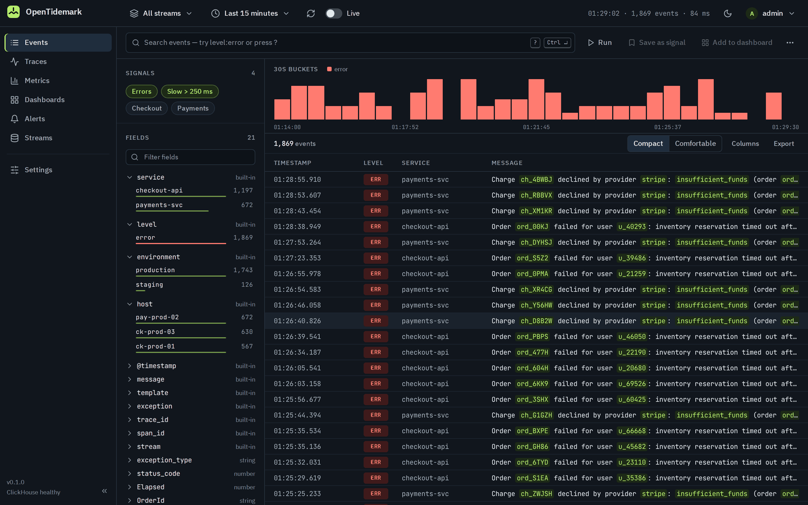
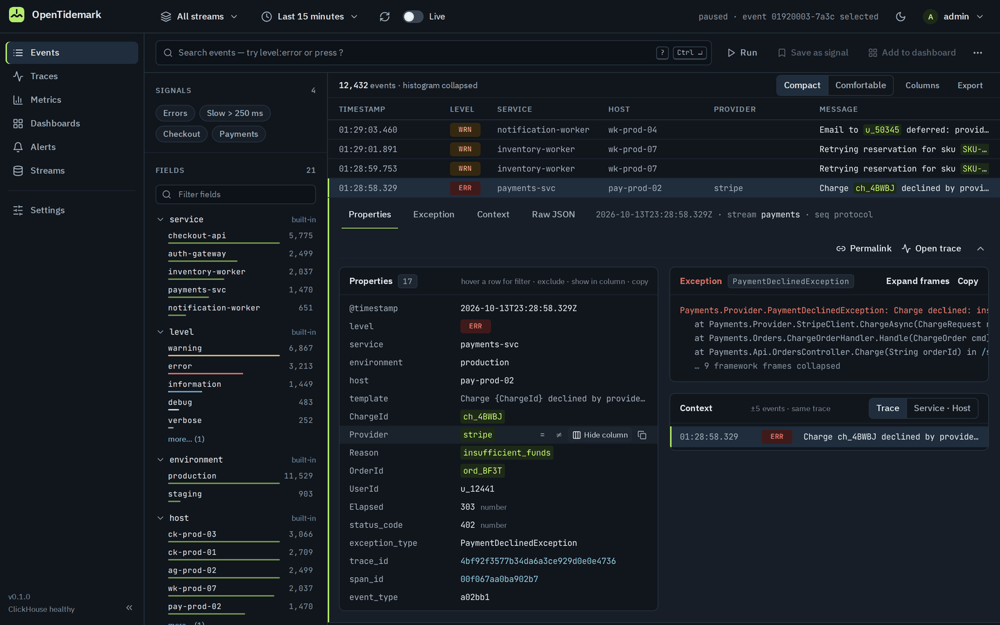
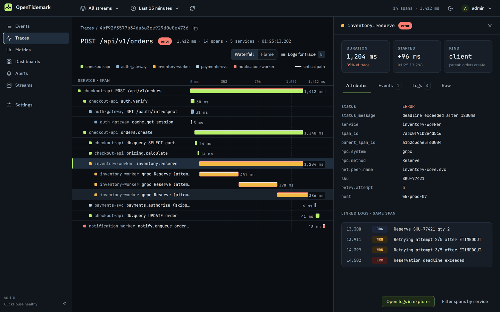
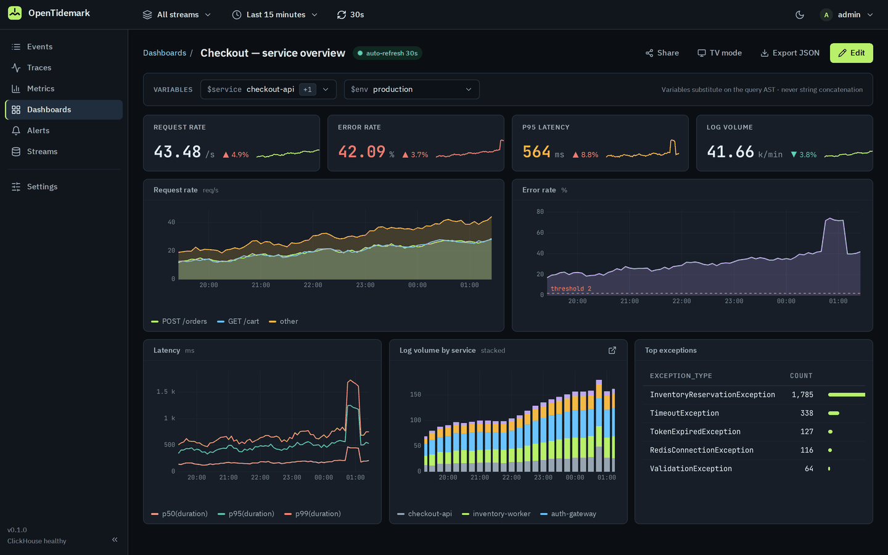
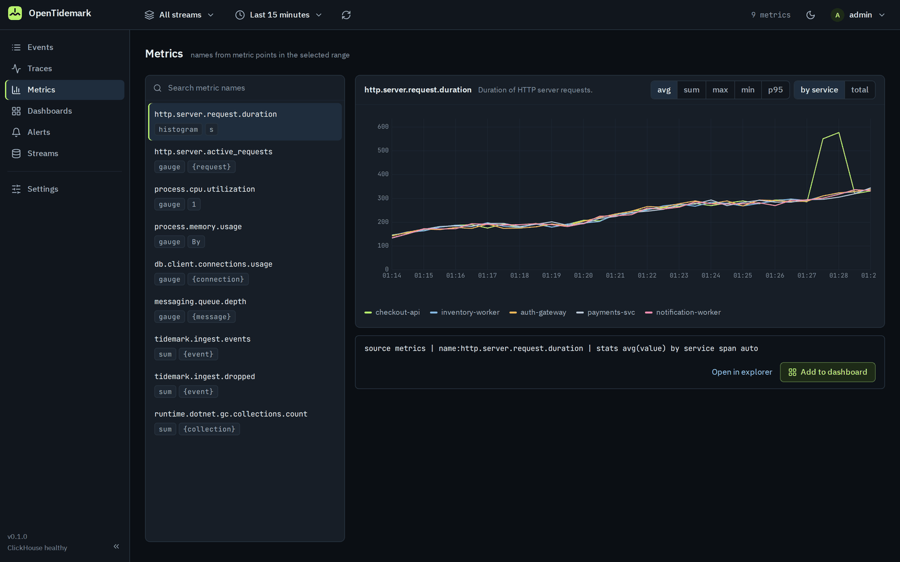
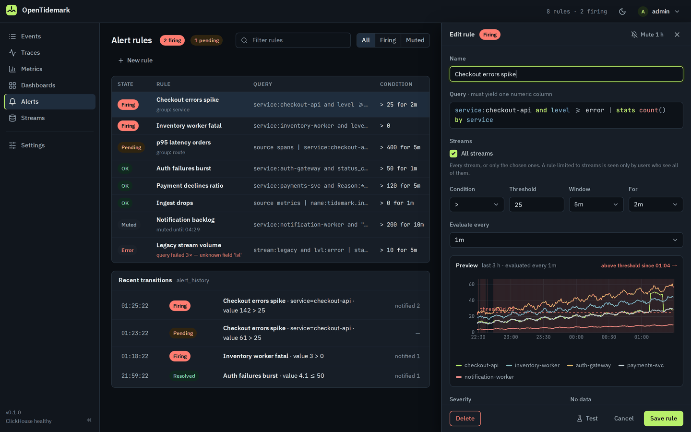
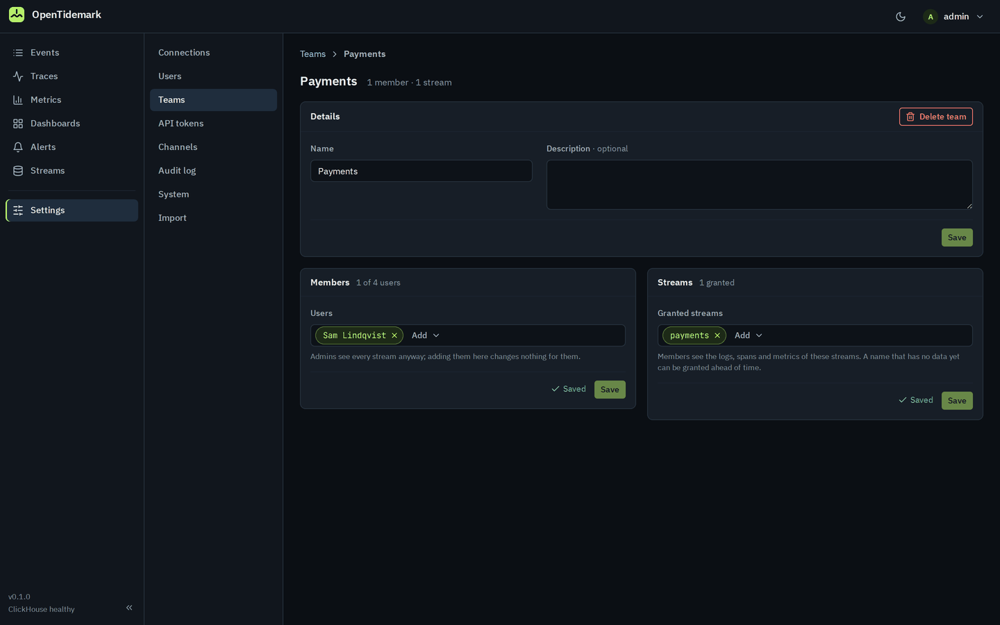

<!-- SPDX-License-Identifier: Apache-2.0 -->
---
template: home.html
hide:
  - navigation
  - toc
---
# OpenTidemark: self-hosted logs, metrics and traces

OpenTidemark is an open-source, self-hosted observability platform for logs, metrics and
distributed traces. It accepts OpenTelemetry® (OTLP gRPC and HTTP), the Seq ingestion API used by
Serilog and NLog, and Elasticsearch `_bulk` from Filebeat, Fluent Bit and Vector, stores
telemetry in ClickHouse® and searches all of it with one query language: a self-hosted
alternative to Seq and to Elasticsearch/Kibana, licensed under Apache-2.0 with every feature
included and no user limits.

[Read the docs](overview.md){ .tm-btn .tm-btn--primary } [Quick start](quickstart.md){ .tm-btn } [Source on GitHub](https://github.com/ZeraOrg/opentidemark){ .tm-btn .tm-btn--ghost }
{ .tm-cta }

**Early 0.x release.** Ingestion, search, the web UI, dashboards, alerting, stream management,
high availability and the importers are implemented and tested; expect rough edges and breaking
changes between minor versions before 1.0. Your data is always kept on upgrade.
{ .tm-status }

{ .tm-hero-shot }

## Keep your clients, change a URL { #clients }

Applications and shippers keep their existing clients and only change a URL and an API key.
Each ingestion connection has its own key.
{ .tm-lede }

- **OpenTelemetry** SDKs and the Collector: OTLP over gRPC and HTTP, for logs, traces and metrics.
- **Serilog and NLog** through the Seq ingestion API.
- **Filebeat, Fluent Bit and Vector** through Elasticsearch `_bulk`.
- **Logstash** through its `http` output to the native JSON endpoint.
- **Seq and Elasticsearch/OpenSearch** data and saved searches, moved over with `tidemark import`.

## One place for logs, traces and metrics { #capabilities }

Everything is searched with one query language, from a quick `level:error service:checkout*` to
`level >= warning | stats count() by service span 5m`, and any result can become a dashboard
panel or an alert. The screenshots use the web UI's built-in demo data.
{ .tm-lede }

- 
  **Log explorer.** Live tail, a time histogram, saved signals, field facets with top values, and
  event detail with filter, exclude, show-in-column and copy actions on every property.
- 
  **Traces.** A waterfall with the critical path, span attributes and the span's own logs.
- 
  **Dashboards.** Variables, stat tiles with sparklines, line, area and stacked-bar charts, and
  tables, built with a visual panel builder or from any query.
- 
  **Metrics.** Browse metric names and chart any of them by service, ready to add to a dashboard.
- 
  **Alerts.** Rules on any query with a preview against recent data, grouping, and webhook,
  Slack, Teams or email notifications.
- 
  **Teams and scope.** Admins grant each team the streams it may see; every search, trace,
  metric and alert respects it, and a scope picker narrows any view to some streams or an
  environment.

## Built to be trusted on your own hardware { #trust }

Logs, metrics and traces are how you find out what your software is really doing. That insight
should be available to everyone, not only to companies that can pay per-gigabyte SaaS prices.
{ .tm-lede }

- **Your telemetry stays with you.** OpenTidemark makes no outbound connections of its own: no
  telemetry, no update checks, no phoning home. It only connects where you configure it to.
- **Nothing loaded from third parties.** The web UI's Content Security Policy is
  `default-src 'self'` and its fonts are bundled.
- **Secrets protected at rest.** Passwords are hashed with argon2id; API tokens, connection keys
  and sessions are stored only as SHA-256 hashes; channel secrets are encrypted with AES-GCM.
- **Open, with nothing held back.** Apache-2.0, every feature included, no editions, licence
  keys or user limits, and you can read every line of code.
- **Verifiable releases.** Each release has `checksums.txt` and GitHub build provenance
  attestations, and is published only after its dependencies pass a supply-chain scan.
- **Durable, optionally highly available.** A write-ahead log keeps acknowledged data, upgrades
  never lose data, and several nodes can run behind a load balancer.

## Up and running in minutes { #get-started }

OpenTidemark needs a ClickHouse server; the Docker Compose bundle brings one along. It also
runs natively on Linux and Windows as a single binary.
{ .tm-lede }

1. Download `tidemark_<version>_docker.tar.gz` (or `.zip`) from the
   [releases](https://github.com/ZeraOrg/opentidemark/releases) on a computer with Docker and
   Compose v2.
2. Unpack it and run the installer, which creates `.env` with random passwords and an ingest
   key and starts the stack:

    ```bash
    tar -xzf tidemark_<version>_docker.tar.gz
    cd tidemark_<version>_docker
    ./install.sh docker
    ```

3. Open <http://localhost:8080>, sign in with **admin / admin** and change the password right
   away. Create a connection and point your clients at it.

[Follow the quick start](quickstart.md){ .tm-btn .tm-btn--primary } [Installation guide](installation.md){ .tm-btn }
{ .tm-cta }

## Documentation { #docs }

- [Documentation overview](overview.md): every guide and the operations manual on one page.
- [Sending data](ingestion.md): OpenTelemetry, Seq, Elasticsearch `_bulk` and native JSON,
  connection keys and field mapping.
- [Query language (TQL)](query-language.md): filters, operators and pipe stages for analytics.
- [Migrating from Seq](migrate-from-seq.md) and
  [from Elasticsearch and Kibana](migrate-from-elastic.md).
- [Operations manual](manual/index.md): deployment, hardening, teams, retention, alerting,
  day-2 operations and the automation API.
- [Guide for agents](manual/agents.md), plus
  [`llms.txt`](https://zeraorg.github.io/opentidemark/llms.txt) and
  [`llms-full.txt`](https://zeraorg.github.io/opentidemark/llms-full.txt) for language models.
